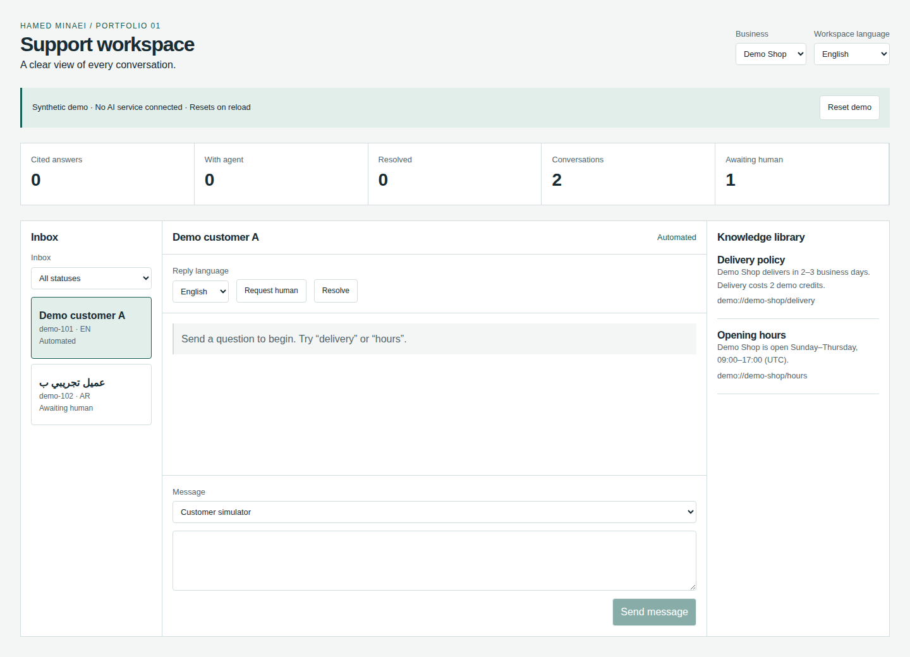

# Customer Support Workspace

A portfolio extension of [Vercel Chatbot](https://github.com/vercel/chatbot), developed by Hamed Minaei. Adds an interactive support workspace with English, Arabic and Persian interfaces, source-backed knowledge lookup, and explicit human takeover.

**Status: synthetic portfolio prototype, not production-ready.** The new workspace uses deterministic keyword retrieval and synthetic in-memory data. It does not call an LLM. The upstream AI chat application remains available separately and requires its own services. The isolated static client can be built separately; the full backend still requires license clearance and disposable-service integration testing. See [Security](#security).

## Architecture

| Layer | Responsibility |
| --- | --- |
| `app/support-demo` | Public synthetic dashboard, inbox, language controls and knowledge library |
| `lib/support/engine.ts` | Pure immutable conversation transitions, scoped retrieval, validation and metrics |
| `lib/support/fixtures.ts` | Fictional businesses, customers and translated policies |
| Upstream application | Existing Next.js chat, AI SDK integration, authentication, PostgreSQL and Redis plumbing |

The new demo runs entirely in browser memory, with no server mutation endpoint, database, persistent storage or external AI request. Reloading resets the data. Business scoping is a retrieval invariant in the demo, **not a server-side tenant authorization system**. The browser intentionally receives all synthetic fixtures.

Conversation lifecycle: automated → waiting → human → resolved. A manual resume can return a waiting, human-owned or resolved conversation to automation. Waiting and human-owned conversations suppress automated replies. Unsupported or tied retrieval results escalate rather than generate an unsupported answer.

## Features

- Business-scoped dashboard metrics derived from conversation state.
- Inbox status filters and two fictional businesses.
- English, Arabic and Persian interface, localized answers, and RTL layouts.
- Normalized Unicode token lookup with article citations and conservative ambiguity handling.
- Explicit handoff, agent claim, assigned-agent reply, resolution and resume controls.
- A customer simulator for repeatable testing; no external message is sent.
- Input limits and immutable conversation history updates.

The new workflow is isolated at `/support-demo`. It is not yet integrated with the upstream chat message API, identity system or persistent storage. Upstream LLM chat does not inherit the demo's handoff policy.

## Installation

Prerequisites: Node.js 24 and pnpm 10.32.1 (declared in `package.json`).

```bash
pnpm install --frozen-lockfile --ignore-scripts
pnpm demo:support
```

Open `http://127.0.0.1:3100/support-demo`. No `.env.local` or service key is needed for this route. Do not enter real customer information.

For a production-mode **local** preview:

```bash
pnpm exec next build
pnpm exec next start --hostname 127.0.0.1 --port 3100
```

The default upstream `build` script also invokes database migrations; use it only with an explicitly configured disposable database. For the original application setup, see [the preserved upstream README](docs/UPSTREAM_README.md).

## Configuration

`.env.example` documents optional upstream services. No credentials are committed. The new demo has no environment-dependent runtime behavior.

To change fictional policies, edit `lib/support/fixtures.ts`. Each article requires a business ID, stable source ID, translated title/answer and retrieval keywords. To add a language, extend the `Locale` type, UI dictionary and all policy translations together.

Do not configure a production database, Smart Visions environment, customer account, API key or actual messaging channel for this demonstration.

## Security

- Existing upstream routes retain their authentication proxy. Only the exact `/support-demo` path receives a public-page exception.
- User input is rendered as React text; no raw HTML injection or tool execution is introduced.
- The client-side agent identity is deliberately simulated. It cannot authenticate operators or authorize customer access.
- Knowledge citations identify local fixtures, not independently verified external facts.
- There is no automated outbound messaging, customer import or persistent transcript storage in the added workspace.
- The remediated lockfile audit reports **0 critical, 0 high, 3 moderate and 1 low** entries. The high/critical CI gate remains enabled. These package-manager counts do not prove exploitability or security. See [the security review](docs/support/SECURITY_REVIEW.md).
- Full backend redistribution remains blocked by unresolved BotID SDK license terms. The separate static build allowlists only the support client, engine, fixtures and React runtime, preserves their notices, and rejects backend/provider SDK inputs. Its CSP disables network connections. It does not deploy the original chat application.

Production work requires resolving remaining dependency and license findings, server-side business authorization, real agent identity, durable storage, rate limits, privacy/retention controls, and integration tests for the actual model/provider and handoff channel.

## Testing

```bash
pnpm test:support
pnpm typecheck
pnpm exec biome check lib/support app/support-demo tests/support tests/support-browser playwright.support.config.ts proxy.ts
pnpm exec next build
pnpm test:support:smoke
pnpm exec playwright install --with-deps chromium
pnpm test:support:e2e
pnpm audit --audit-level high
pnpm build:support:static
pnpm test:support:static
```

The 18 policy tests exercise multilingual citations, business isolation, ambiguity, unsupported questions, handoff suppression, agent ownership, lifecycle transitions and validation. The smoke test starts the built server, checks the public demo, and verifies authentication redirects for the existing root and malformed bearer headers. Five Playwright cases cover the main flow, RTL, responsive overflow and screenshots at 320/768/1024/1440 pixels.

[Baseline and verification results](docs/support/VERIFICATION.md) distinguish passing checks from blocked browser verification. `.github/workflows/support-workspace.yml` runs these checks without external credentials and uploads browser results. The inherited upstream E2E suite remains separate and service-dependent; it has not been represented as passing.

## Demo

Follow [the repeatable walkthrough](docs/support/DEMO.md). **[Open the live synthetic demo](https://hamed665.github.io/ai-customer-support-saas/support-demo/).** GitHub Pages deployment run 39333048647 succeeded and the live citation flow was checked in a browser. To preview its output locally, run `pnpm build:support:static` then `python3 -m http.server 3197 --bind 127.0.0.1 --directory dist-demo` and open `/support-demo/`. Six static browser cases include the existing five UI checks plus CSP network blocking and reload reset. GitHub Pages deploys only after tests and the security gate pass on main. All five browser cases passed in GitHub Actions. Actual screenshots are stored in `docs/support/screenshots/` (320/768/1024/1440px). Local Chromium installation remains unavailable. No mock image is presented as an application screenshot.



## Attribution

Based on `vercel/chatbot` commit `c2f8235e1f3ea903ad8b7f61447c4f74164b5c58`, upstream commit date 2026-07-08. The complete upstream Git history and original [Apache 2.0 license notice](LICENSE) are retained. Upstream code remains Copyright 2024 Vercel, Inc.

Hamed Minaei's additions: `app/support-demo/**`, `lib/support/**`, support tests and scripts, support CI workflows, `demo-static/**`, static build/browser verification and `docs/support/**`. Modified upstream files: `app/layout.tsx` and `components/support/app-session-provider.tsx` (avoid auth-session requests on the synthetic demo only), `proxy.ts` (exact public synthetic demo route), `package.json` / `pnpm-lock.yaml` (verification scripts and dependency remediation), `next.config.ts` (obsolete option removal), `components/ai-elements/reasoning.tsx` (Streamdown prop compatibility), `.env.example` (optional-service guidance), and this README. The original README is preserved in `docs/UPSTREAM_README.md`. No upstream authorship or contribution dates have been rewritten.

These additions are licensed under Apache-2.0; dependency licenses remain their respective authors' licenses. This project is not endorsed by Vercel. See [NOTICE](NOTICE).
